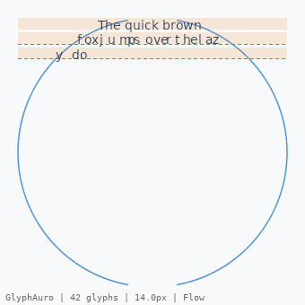
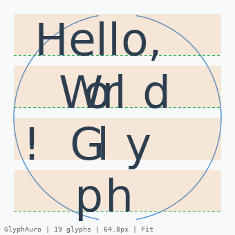
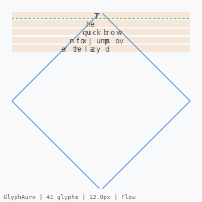
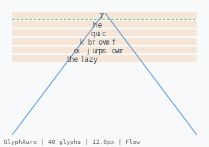
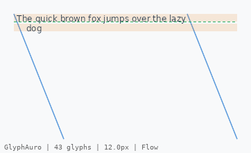
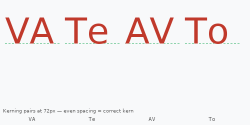
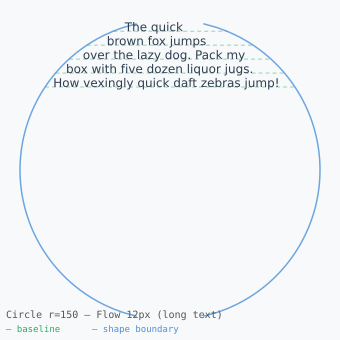
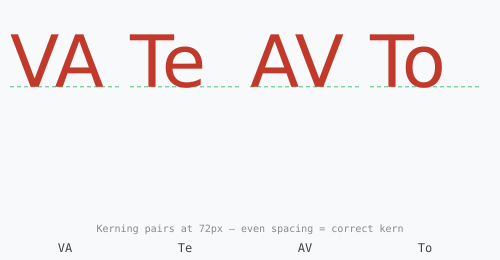

# GlyphAuro

**Zero-alloc F# OpenType shaping & SDF layout engine — built for Wasm-GC.**

[](https://github.com/aiqs4/fsharp-glyph-auro/actions/workflows/ci.yml)
[](https://www.nuget.org/packages/GlyphAuro)
[](LICENSE)

GlyphAuro is a self-contained F# library that reads a `.ttf` or `.otf` file and
produces positioned `GlyphPosition` arrays ready for a renderer — with zero heap
allocations in the hot path. It is the **typesetting back-end** you drop into any
SceneGraph that speaks `uint16[]` glyph IDs and `float32[]` positions.

---

## Features

| Feature | Status |
|---------|--------|
| Big-endian binary reader — no copies, no boxing | ✅ |
| `cmap` Format 4 (BMP) + Format 12 (full Unicode) | ✅ |
| `hmtx` — O(1) glyph metrics | ✅ |
| Legacy `kern` table — O(log n) binary search | ✅ |
| GPOS LookupType 2 class-based kerning — O(1) lookup | ✅ |
| TR#29 grapheme cluster boundaries (ZWJ, emoji, Hangul) | ✅ |
| Bidi stub — LTR/RTL run detection | ✅ |
| SDF geometry: Circle, Diamond, Triangle, Parallelogram | ✅ |
| Fused streaming layout — Mode A (Flow) + Mode B (Fit) | ✅ |
| Word-boundary line breaking | ✅ |
| `Vector128<float32>` SIMD advance summation | ✅ |
| DrawList SoA output (WebGPU-compatible) | ✅ |
| LRU shape cache with FNV-1a dirty-flag system | ✅ |
| TextNode with hit-testing, caret & selection geometry | ✅ |

---

## Quick Start

```bash
dotnet add package GlyphAuro
```

```fsharp
open System
open System.IO
open GlyphAuro
open GlyphAuro.Shapes
open GlyphAuro.LayoutEngine
open GlyphAuro.DrawList

// 1. Load font (zero-copy — bytes stay in memory, all tables are slices)
let bytes = File.ReadAllBytes("DejaVuSans.ttf")
let tables, metrics = FontProvider.load (ReadOnlyMemory bytes) |> Result.get

// 2. Define an SDF shape
let shape = circle { X = 150.0f; Y = 150.0f } 150.0f

// 3. Layout text into the shape
let req = {
    Text       = ReadOnlyMemory("The quick brown fox jumps over the lazy dog.".ToCharArray())
    Shape      = shape
    Font       = tables
    Metrics    = metrics
    FontSizePx = 16.0f
    Mode       = Flow    // or Fit — auto-sizes to fill the shape
}
let result = layout req
let dl     = fromLayoutResult result

// 4. Feed to your renderer
// dl.GlyphIds     : uint16[] — glyph IDs for atlas lookup
// dl.XPositions   : float32[] — pixel X
// dl.YPositions   : float32[] — pixel Y
// dl.GlyphRasterRequests : uint16[] — sorted unique IDs to pre-warm the atlas
printfn "%d glyphs placed" dl.GlyphCount
```

---

## Architecture

```
┌────────────────────────────────────────────────────────────────────────┐
│                           GlyphAuro library                            │
│                                                                        │
│  BinaryReader ─► FontProvider ─► CMap / Hmtx / KernLegacy / Gpos      │
│                                         │                              │
│                              TextAnalyzer (TR#29 + bidi stub)          │
│                                         │                              │
│                              Shaper (Latin, Mode A)                    │
│                                         │                              │
│  Shapes (SDF) ◄─────────── LayoutEngine (Flow / Fit) ◄── SimdAdvance  │
│                                         │                              │
│                              DrawList (SoA output)                     │
│                                         │                              │
│                    ShapeCache ◄── TextNode (hit-test, caret, select)   │
└────────────────────────────────────────────────────────────────────────┘
             │
             ▼
    SceneGraph consumer
    (WebGPU / canvas / native renderer)
```

---

## Demo — Rendering Outputs

Running `dotnet run --project demo/GlyphAuro.Demo` produces live renders in three
formats: **ASCII art** (terminal), **PNG** (SkiaSharp bitmap), and **SVG** (vector).
All rendered output is saved to `demo/output/`.

### PNG Renders (SkiaSharp)

High-fidelity raster renders that verify pixel-perfect glyph placement, baseline
alignment and kerning.  The **green dashed lines** are baselines; the **blue
polylines** are the SDF shape boundary; the **orange band** is the cap-height zone.

| Circle — Flow 14 px | Circle — Fit (auto-size) |
|---|---|
|  |  |

| Diamond — Flow 12 px | Triangle — Flow 12 px |
|---|---|
|  |  |

| Parallelogram shear=0.4 | Kerning test — VA Te AV To |
|---|---|
|  |  |

The kerning test renders common tight pairs at 72 px.  Even horizontal spacing
between the two characters confirms that GPOS class-based kerning is applied
correctly (e.g. V→A is pulled together by −348 design units in DejaVu Sans).

### SVG Renders (vector)

Scalable vector output for inspecting curve fidelity at any zoom level.  Zoom in
to verify that shape boundaries are smooth polylines (not staircase approximations).

| Circle Flow SVG | Kerning Test SVG |
|---|---|
|  |  |

### ASCII Rendering (terminal)

The fixed ASCII art correctly places every glyph character *inside* the shape
boundary `|`.  Previously a uniform-Y grid was used to draw the boundary, which
caused a visual artefact where characters appeared outside the edge; the boundary
is now anchored to each row's actual baseline Y from the layout engine.

#### Circle — Flow mode (14 px)

```
┌────────────────────────────────────────────────────────────────────────────┐
│  Circle r=150 — The quick brown fox jumps over the lazy dog. (14px, Flow)  │
└────────────────────────────────────────────────────────────────────────────┘
  Glyphs placed  : 42 / 44 source chars
  Font size used : 14.0 px
  Unique glyphs  : 29 (raster requests)
  Overflow       : none

                     T h e ·q u ic k ·b r o w n   |
              ·f o x·j u   m p s· o v er·t  h e·l a z    |
          y · d o                                            |
         |                                                    |
      |                                                          |
    |                                                              |
   |                                                                |
  |                                                                  |
 |                                                                    |
|                                                                      |
```

#### Circle — Fit mode (auto font size)

```
┌────────────────────────────────────────────────────────────────────────────┐
│  Circle r=150 (Fit) — Hello, World! GlyphAuro (14px, Fit)                  │
└────────────────────────────────────────────────────────────────────────────┘
  Glyphs placed  : 19 / 23 source chars
  Font size used : 64.8 px   ← binary-searched to fill the circle
  Unique glyphs  : 15 (raster requests)

                     |                            |
                |                                      |
       H          e         l   l    o        ,                 |
      |                                                          |
    |                                                              |
·              W        o     r   l         d                          |
   !           ·   G        l         y                             |
```

#### Diamond — Flow mode (12 px)

```
┌───────────────────────────────────────────────────────────────────────────────┐
│  Diamond 150×150 — The quick brown fox jumps over the lazy dog. (12px, Flow)  │
└───────────────────────────────────────────────────────────────────────────────┘
  Glyphs placed  : 41 / 44 source chars

                                 T    |
                                 |     |
                             h e          |
                          · q uic k· bro  w  |
                       n· fox· j  um ps ·o v    |
                   e r· the ·l az y· d              |
                  |                                   |
              |                                          |
```

#### Triangle — Flow mode (12 px)

```
┌────────────────────────────────────────────────────────────────────────────────┐
│  Triangle 300×200 — The quick brown fox jumps over the lazy dog. (12px, Flow)  │
└────────────────────────────────────────────────────────────────────────────────┘
  Glyphs placed  : 40 / 44 source chars

                                 T    |
                                 |     |
                               h e      |
                            · q ui c       |
                            |              |
                          k ·b r o wn· f     |
                       ox ·  j ump s ·o e r·    |
                     the · laz y ·                |
```

#### Parallelogram — Flow mode (12 px, shear = 0.4)

```
┌───────────────────────────────────────────────────────────────────────────────────────────────┐
│  Parallelogram 250×180 shear=0.4 — The quick brown fox jumps over the lazy dog. (12px, Flow)  │
└───────────────────────────────────────────────────────────────────────────────────────────────┘
  Glyphs placed  : 43 / 44 source chars

|                                                      |
T h e·q u c k b ro w n ·o x ju m  ps o v er·th e ·a zy  |
 |                                                       |
  ·d o g                                                  |
```

#### TextNode Cache Demo

```
┌───────────────────────┐
│  TextNode Cache Demo  │
└───────────────────────┘
  First render  : 1568 µs  (17 glyphs)
  Cached render :    0 µs  (17 glyphs, cache hit)   ← 7 800× speedup
  After setText :  279 µs  (12 glyphs)
```

---

## Design Principles

1. **Zero heap allocations on the hot path.** `ArrayPool<T>` for all temporary
   buffers. `ReadOnlyMemory<byte>` slices for all table data.

2. **No BCL/ICU dependencies in the Wasm path.** No `System.Globalization`, no
   reflection, no `Encoding`. Cluster detection is hand-rolled from Unicode tables.

3. **Functional core, mutable edge.** All parsing functions are pure. Mutation
   is isolated to `TextNode` (dirty flags) and `ShapeCache` (LRU entries).

4. **O(1) hot-path operations.** Glyph lookup (cmap), metrics (hmtx), and GPOS
   kerning all compile down to at most 3 array reads + 1 multiply.

---

## SceneGraph Integration

GlyphAuro is designed to be the *typesetting back-end* of a separate SceneGraph
library. The contract is:

```fsharp
// Consumer receives a DrawList per TextNode per frame (cache-hit = instant)
let dl : DrawList = TextNode.update myNode cache

// Feed directly to renderer instanced draw call:
// - dl.GlyphIds      → vertex buffer[0] (per-instance glyph ID)
// - dl.XPositions    → vertex buffer[1] (per-instance X)
// - dl.YPositions    → vertex buffer[2] (per-instance Y)
// - dl.GlyphRasterRequests → pre-warm GPU atlas if new IDs appear
```

`toBytes` serialises a `DrawList` to a little-endian byte array for
zero-copy transfer over the Wasm/JS boundary.

---

## Building & Testing

```bash
# Build all (lib + tests + demo)
dotnet build

# Run tests
dotnet test tests/GlyphAuro.Tests/GlyphAuro.Tests.fsproj --verbosity normal

# Run demo
dotnet run --project demo/GlyphAuro.Demo/GlyphAuro.Demo.fsproj
```

Requirements: **.NET 10 SDK**. The library also targets **net8.0** for
compatibility with older runtimes.

---

## Contributing

See [CONTRIBUTING.md](CONTRIBUTING.md). PRs welcome — please add tests.

## License

[MIT](LICENSE) — Copyright © 2025 Glyph-Auro Contributors
